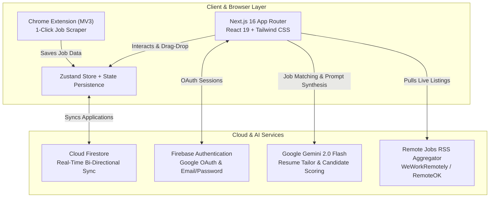

# 🎯 JobHelper — AI-Powered Career Command Center

[](https://github.com/eresfavolosx/JobHelper/actions/workflows/ci.yml)
[](https://nextjs.org/)
[](https://react.dev/)
[](https://deepmind.google/technologies/gemini/)
[](https://firebase.google.com/)
[](https://opensource.org/licenses/MIT)

> A modern, full-stack career platform engineered to streamline tech job hunting with automated tracking, Chrome extension 1-click job parsing, and real-time AI resume tailoring powered by **Google Gemini 2.0 Flash**.

---

## 🏗️ Architecture Overview



---

## ✨ Key Features

- **⚡ Interactive Kanban Command Center**: Fluid drag-and-drop pipeline (`Wishlist` → `Applied` → `Interviewing` → `Offer` → `Rejected`) with analytics charts, undo toasts, and search filtering.
- **🧩 1-Click Chrome Extension (Manifest V3)**: Save job postings directly from LinkedIn, Indeed, Glassdoor, and career pages into your personal pipeline with automatic packaging.
- **🤖 Gemini 2.0 Flash Resume Tailoring & Match Scoring**:
  - Automatically matches job postings against your profile requirements, skills, and target salary.
  - Scores match percentage (0–100%) with explanatory rationale.
  - Generates custom, ATS-optimized resume bullet points and tailored cover letters.
- **📡 Remote RSS Job Aggregation**: Live background ingest of remote opportunities from WeWorkRemotely and RemoteOK with keyword deduplication.
- **🔐 Enterprise Authentication & Cloud Sync**: Full Firebase Auth supporting Google OAuth & secure Email/Password, backed by Cloud Firestore real-time listeners.
- **🐳 Production Ready**: Includes multi-stage Docker builds, Docker Compose, automated Node 20+ CI test suites, and ESLint flat config.

---

## 🛠️ Tech Stack

| Domain | Technologies |
| :--- | :--- |
| **Framework** | Next.js 16 (Turbopack, App Router), React 19 |
| **State Management** | Zustand 5 (with persistent local & cloud sync) |
| **Styling & UI** | Tailwind CSS, Lucide React, Recharts, @dnd-kit |
| **AI Integration** | Google Generative AI (`@google/generative-ai`, Gemini 2.0 Flash) |
| **Auth & Database** | Firebase Authentication (OAuth & Email), Cloud Firestore |
| **Testing & CI** | Native Node Test Runner (`node:test`), ESLint 9, GitHub Actions |
| **Containerization** | Docker (multi-stage alpine), Docker Compose |

---

## 🚀 Getting Started

### Prerequisites

- **Node.js**: v18.18 or higher (v20+ recommended)
- **Gemini API Key**: [Get a free key from Google AI Studio](https://aistudio.google.com/app/apikey)
- **Firebase Project**: A Firebase web app with Authentication (Email & Google) and Firestore enabled.

### 1. Clone & Install

```bash
git clone https://github.com/eresfavolosx/JobHelper.git
cd JobHelper
npm install
```

### 2. Configure Environment

Copy the example configuration file:

```bash
cp .env.local.example .env.local
```

Populate `.env.local` with your credentials:

```ini
NEXT_PUBLIC_GEMINI_API_KEY=your_gemini_api_key_here
NEXT_PUBLIC_FIREBASE_API_KEY=your_firebase_key
NEXT_PUBLIC_FIREBASE_AUTH_DOMAIN=your_project.firebaseapp.com
NEXT_PUBLIC_FIREBASE_PROJECT_ID=your_project_id
NEXT_PUBLIC_FIREBASE_STORAGE_BUCKET=your_project.appspot.com
NEXT_PUBLIC_FIREBASE_MESSAGING_SENDER_ID=your_sender_id
NEXT_PUBLIC_FIREBASE_APP_ID=your_app_id
```

### 3. Run Locally

```bash
npm run dev
```

Open [http://localhost:3000](http://localhost:3000) in your browser.

---

## 🧩 Installing the Chrome Extension

Building the project automatically generates a deployable zip in `public/extension.zip`, or you can load unpacked directly:

1. Navigate to `chrome://extensions` in Chrome.
2. Toggle on **Developer mode** in the top right.
3. Click **Load unpacked**.
4. Select the `src/extension` directory from this repository.
5. Click the extension icon on any job posting to automatically parse and save it to your Kanban board!

---

## 🧪 Running Tests & Quality Checks

Run the automated test suite powered by Node's native test runner:

```bash
# Run unit & integration tests
npm test

# Run ESLint quality checks
npm run lint

# Compile production build & package extension
npm run build
```

---

## 🐳 Docker Deployment

To run JobHelper with Docker Compose:

```bash
docker compose up -d --build
```

The app will be accessible at [http://localhost:3000](http://localhost:3000).

---

## 👨‍💻 Author

**Fabián Vélez Vicente**  
- **GitHub**: [@eresfavolosx](https://github.com/eresfavolosx)  
- **LinkedIn**: [Fabián Vélez Vicente](https://linkedin.com/in/fabianvelez)  

---

## 📄 License

This project is licensed under the [MIT License](LICENSE).
