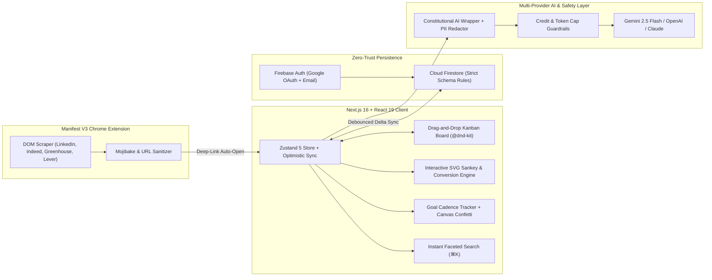

<div align="center">

# 🎯 NovuJobs (`JobHelper`) — AI Career Command Center & Pipeline Analytics

**Full-Stack Job Application Operating System · Multi-Stage Sankey Funnel Analytics · Constitutional AI Career Coach · Manifest V3 Chrome Extension**

[](https://jobhelper.novu.works)
[-000000?style=for-the-badge&logo=next.js&logoColor=white)](https://nextjs.org/)
[](https://react.dev/)
[](https://firebase.google.com/)
[-22c55e?style=for-the-badge&logo=node.js&logoColor=white)](#testing--quality-assurance)

</div>

---

## ⚡ Executive Overview

**NovuJobs (`JobHelper`)** is a production-grade career pipeline and conversion analytics platform built with **Next.js 16 (App Router)**, **React 19**, **Zustand 5**, **Firebase Authentication & Cloud Firestore**, and **multi-provider LLM orchestration** (**Google Gemini 2.5**, **OpenAI GPT-4o**, and **Anthropic Claude**).

Designed for high-velocity engineering and growth job searches, it pairs a 1-click **Manifest V3 Chrome Extension** scraper with real-time **Kanban pipeline management**, an interactive **Sankey Diagram & Conversion Rate Engine**, **Daily/Weekly Application Cadence Tracking** with full-screen celebration physics, and an **AI Career Coach** protected by **Constitutional AI safety guardrails** and **PII redaction**.

---

## 🏗️ System Architecture



---

## ✨ Key Engineering Features

### 1. 📊 Interactive Sankey Pipeline Flow & Conversion Analytics (`src/components/JobSankeyChart.js`, `src/lib/sankey-utils.js`)
- **Multi-Stage Conversion Funnel & Direct Breakdown Modes**: Custom vector cubic-Bézier Sankey layout engine computing proportional node heights and variable-width flow ribbons across 5 hiring stages (`Pipeline Entry` → `Initial Triage` → `Screening Loop` → `Interview Loop` → `Offer Decision`).
- **Real-Time Conversion KPIs**: Automatically tracks **Callback / Screening Rate**, **Interview Conversion Rate**, **Offer Success Rate**, **Interview-to-Offer Win Rate**, and **Active vs. Resolved Pipeline** share.
- **Automatic Stage Transition History**: `moveJob` and `updateJob` in `src/lib/store.js` automatically record `previousStatus` on every stage transition so rejections and archives are attributed to the exact stage reached (`Applied`, `Initial Screening`, `Interviewing`, or `Offer`).
- **Interactive Role Inspector & Export**: Click or keyboard-navigate (`Tab` + `Enter`/`Space`) any node or flow ribbon to inspect the exact roles in that transition, toggle a semantic accessibility data `<table>`, copy a formatted Markdown summary, or export a standalone `.svg`.

### 2. 🎯 Application Cadence Command Center & Goal Celebration (`src/components/GoalTrackerWidget.js`, `src/components/GoalCelebrationOverlay.js`)
- **Configurable Cadence Targets**: Supports **Daily** (e.g., `5 applications/day`), **Weekly**, **Monthly**, and **Total Pipeline** goals with streak tracking, pace diagnostics (`Ahead`, `On Track`, `Behind`), and automatic time-series chart granularity switching (`src/components/ApplicationHistoryChart.js`).
- **60 FPS Full-Screen Confetti & Fireworks Overlay**: Achieving the active application goal triggers a hardware-accelerated HTML5 Canvas celebration (`170+` multi-shape particles + secondary bursts) with a congratulatory achievement banner and full `prefers-reduced-motion` compliance.

### 3. 🤖 Multi-Provider AI Career Coach & Constitutional AI Safety (`src/lib/ai-safety.js`, `src/lib/gemini-client.js`)
- **Resume Tailoring & Fit Scoring**: Generates tailored cover letters, high-impact resume bullet rewrites, and deterministic + LLM relevance scores against live remote tech RSS feeds (`src/lib/job-service.js`).
- **Adversarial Prompt Injection & PII Redaction**: Every untrusted job description or resume snippet passes through `src/lib/ai-safety.js` to detect prompt-injection/jailbreak patterns and automatically redact SSNs, credit card numbers, API keys, and plaintext credentials before LLM dispatch.
- **Credit & Quota Guardrails**: Enforces per-user monthly token/request caps (`src/lib/credit-protection.test.mjs`) with automatic deterministic fallback scoring when offline or rate-limited.

### 4. 🧩 Manifest V3 Chrome Extension (`src/extension/`)
- **1-Click Job Clipping**: Extracts clean role titles, company names, locations, and canonical URLs directly from LinkedIn, Indeed, Greenhouse, and Lever DOMs (`src/extension/popup.js`), stripping UTF-8 mojibake and zero-width characters and remembering the user's last-used resume link.

### 5. 🛡️ Security, Accessibility (WCAG 2.2 AA) & Performance Hardening
- **Control-Character & Protocol URL Sanitization**: `sanitizeUrl()` (`src/lib/utils.js`) strips ASCII/C1 control characters (`[\x00-\x1F\x7F-\x9F]`) and enforces an explicit `http:`/`https:` allowlist to prevent DOM/Stored XSS.
- **Zero-Trust Firestore Rules**: `firestore.rules` enforces strict per-user document isolation, explicit key allowlists (`hasOnly`), string length bounds, and status enum validation.
- **Accessible by Design**: Semantic `<search>` landmarks, `aria-live="polite"` status announcements (including single-shot undo toast announcements in `src/components/UndoToast.js`), keyboard-navigable Kanban columns and SVG charts, and `light`/`dark`/`system` theming.

---

## 🧪 Testing & Quality Assurance

The repository includes **133 automated unit and integration tests across 35 suites** using Node's native test runner (`node --test`):

```bash
npm test          # Runs all 133 unit & security tests across 11 test modules
npm run lint      # Runs ESLint (React 19 strict hooks & Next.js core-web-vitals)
npm run build     # Packages the Chrome Extension (.zip) and builds the Next.js production bundle
```

| Test Suite | Coverage Area |
| :--- | :--- |
| `src/lib/sankey-utils.test.mjs` | Multi-stage Sankey layout geometry, ribbon path generation, and funnel conversion math |
| `src/lib/goal-tracker.test.mjs` | Daily/weekly/monthly goal cadence evaluation, streak calculation, and pace status |
| `src/components/ApplicationHistoryChart.test.mjs` | Time-series aggregation, zero-skipping daily intervals, and auto-granularity switching |
| `src/lib/ai-safety.test.mjs` | Prompt injection detection, PII redaction, and Constitutional AI wrapper verification |
| `src/lib/credit-protection.test.mjs` | API budget guardrails, monthly hard caps, and BYOK key isolation |
| `src/lib/qa-role-updates.test.mjs` | Email sync intent classification, Ghost Alert detection (`10+` days), and follow-up windows |
| `src/lib/job-search.test.mjs` | Multi-parameter faceted search, stage/location/company filtering, and sorting |
| `src/lib/multi-provider.test.mjs` | Multi-provider LLM routing (Gemini, OpenAI, Anthropic) and fallback resilience |
| `src/lib/utils.test.js` | XML escaping and control-character XSS URL sanitization |
| `src/lib/theme.test.mjs` & `sidebar.test.mjs` | Theme persistence (`light`/`dark`/`system`) and collapsible sidebar state |

---

## 🚀 Local Development

```bash
# 1. Install dependencies
npm install

# 2. Start the Next.js development server (Turbopack)
npm run dev
```

Open [http://localhost:3000](http://localhost:3000) in your browser. To load the companion Chrome Extension locally, navigate to `chrome://extensions`, enable **Developer Mode**, click **Load Unpacked**, and select `src/extension`.
